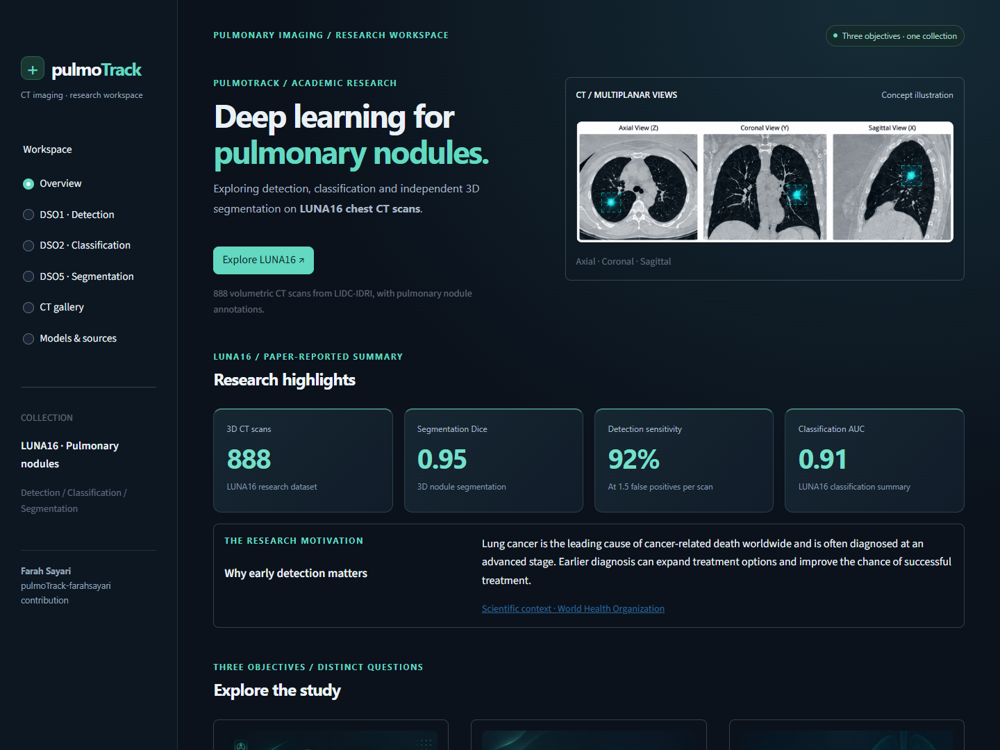

# pulmoTrack-farahsayari contribution

A Streamlit CT research workspace by **Farah Sayari**, covering three distinct objectives on LUNA16:

- **DSO1 — Nodule detection:** candidate screening using 3D CT patches.
- **DSO2 — Nodule classification:** recorded binary true-nodule / false-nodule experiments.
- **DSO5 — Exploratory nodule segmentation:** an independent model-development challenge.

The app uses existing evidence: **123 original PNG figures, one 48-frame Grad-CAM GIF, 15 evaluations and 261 logged epochs**, selected from **12 notebooks**. It requires no CT dataset, model execution or PyTorch installation.



[Live research website](https://pulmotrack-farahsayari-contribution-sef2wgqdo5bzl9wmgfwxry.streamlit.app/) · [Portfolio project details (PDF)](docs/PulmoTrack_Portfolio_Project_Details.pdf) · [Editable portfolio text](docs/PulmoTrack_Portfolio_Project_Details.md)

The seven-page portfolio document covers the project information, technologies, contributions, LUNA16, all six CRISP-DM phases, three objectives, results, deployment and research manuscript. Rebuild it with `python -m pip install -r requirements-docs.txt` followed by `python scripts/build_portfolio_pdf.py`; this optional tooling is separate from the hosted app's dependencies.

## Launch

```powershell
python -m pip install -r requirements.txt
python -m streamlit run app.py
```

Open **http://localhost:8501**, or double-click **run_app.bat** after installing dependencies. To isolate dependencies, create and activate a virtual environment first.

## Deploy on Streamlit Community Cloud

Sign in at [share.streamlit.io](https://share.streamlit.io/), connect GitHub and create an app with:

| Setting | Value |
| --- | --- |
| Repository | `FarahSayari/pulmoTrack-farahsayari-contribution` |
| Branch | `main` |
| Main file | `app.py` |
| Python version (Advanced settings) | `3.11` (the locally tested version) |

The root `requirements.txt` installs the runtime dependencies. No secrets, dataset downloads or model execution are required. Keep the repository private if desired and grant Streamlit access to private repositories. App visibility is configured separately in Streamlit's sharing settings; a private repository produces a private app by default. See the official [deployment guide](https://docs.streamlit.io/deploy/streamlit-community-cloud/deploy-your-app/deploy) and [sharing settings](https://docs.streamlit.io/deploy/streamlit-community-cloud/share-your-app).

## Workspace

- **Overview:** a research showcase with paper-reported LUNA16 highlights, the three objectives, a CRISP-DM presentation of the workflow, personal contributions and Research Resources.
- **DSO1 · Detection:** an illustrated introduction, model architecture, best-checkpoint validation and test evaluations, error interpretation, training history and candidate preparation. Pilot Grad-CAM animation and frame inspection are presented separately from the main study.
- **DSO2 · Classification:** an illustrated introduction and model overview for Improved 3D CNN, ResNet3D Lite and U-Net encoder studies. Each model retains its own cohort, themed evaluation charts, error interpretation and training history.
- **DSO5 · Segmentation:** an illustrated independent research challenge with model overviews, themed metric summaries, cohort-specific interpretation, original prediction examples and training curves. Unavailable scores remain missing; no ROC or confusion matrix is synthesized.
- **CT gallery:** filter original images by objective, study scope and content; download the original PNGs.
- **Models & sources:** ten documented model studies, selected source notebooks, provenance and CSV/JSON downloads. Four segmentation checkpoints are included; other studies are documented by their outputs.

The interface retains the navy/teal radiology theme. Original notebook figures and the GIF are copied unchanged. Controls browse stored figures or GIF frames, not missing CT arrays.

Detection and classification confusion matrices are rendered from their original counts. A display-only SVG color transform adapts the original ROC PNGs to the theme without changing curve geometry; raw probability arrays were not preserved. Original figures remain available for download.

The overview's 0.95 segmentation Dice, 92% sensitivity at 1.5 false positives per scan and 0.91 classification AUC are attributed to the **team project manuscript, pages 4–5**. They are separate from the notebook-derived evaluations below. The original [PulmoTrack paper](assets/paper/PulmoTrackPaper.pdf) is included unchanged, with an 11-page viewer and PDF download. It is presented as a project manuscript, without a claim of peer-reviewed publication. Generated overview illustrations are identified as concept imagery.

## Primary evidence

| Objective | Notebook | Role |
| --- | --- | --- |
| DSO1 | [11_nodule_detection.ipynb](notebooks/11_nodule_detection.ipynb) | Completed 20-epoch U-Net encoder classifier study, validation and test evaluation |
| DSO2 | [11_nodule_classification.ipynb](notebooks/11_nodule_classification.ipynb) | Three binary classification studies |
| DSO5 | [02_Modeling_Segmentation.ipynb](notebooks/02_Modeling_Segmentation.ipynb) | Segmentation architectures, recorded evaluations and examples |
| DSO5 preparation | [01_luna16_Data Acquisition.ipynb](notebooks/01_luna16_Data%20Acquisition.ipynb) | CT preparation and spherical reference masks |

Supporting sources are explicitly listed in `scripts/archive_catalog.py`: the verified 888-scan resampling run, historical lung-mask examples, candidate preparation, 1,215-positive/8,000-negative patch extraction, pilot balancing/splitting and two earlier training notebooks. Incomplete drafts and the Markdown document named `11_nodule_classification_updated.ipynb` are excluded from extraction.

## Interpreting the results

Best-checkpoint accuracy below is calculated from the saved confusion-matrix counts. AUC comes from the corresponding stored evaluation output. No prediction or model is rerun.

| Study | Cohort | Matrix-derived accuracy | ROC-AUC |
| --- | --- | ---: | ---: |
| DSO1 U-Net encoder | Validation, best checkpoint | 98.37% | 0.9928 |
| DSO1 U-Net encoder | Test, best checkpoint | 97.83% | 0.9961 |
| DSO2 Improved 3D CNN | Validation, best checkpoint | 74.50% | 0.8269 |
| DSO2 Improved 3D CNN | Test, best checkpoint | 74.63% | 0.8335 |
| DSO2 ResNet3D Lite | Validation, best checkpoint | 72.07% | 0.7678 |
| DSO2 U-Net encoder | Validation, best checkpoint | 74.00% | 0.8116 |

The notebooks print last-epoch validation accuracies alongside best-checkpoint matrices/AUCs. The interface separates them: last-epoch accuracies appear in training history, while the result cards use the matching matrix cohort. Matrix transcriptions are linked to the original image and checksum in the manifest.

Important study boundaries:

- **Classification is binary.** Normal/benign/malignant classification remains a project goal; these notebooks do not evaluate it.
- **Detection screens provided candidates.** The recorded classifier is not an end-to-end full-volume localization system or a Faster R-CNN implementation.
- **Cohorts differ.** The classification CNN/U-Net validation matrices contain 200 cases; the ResNet matrix contains 401, despite an earlier 200-case split log. There is no common model leaderboard.
- **Pilot studies are small.** They use 196 patches split 137/29/30. CNN test accuracy is 83.33%; ResNet-18 has last/peak validation accuracy 86.21%/96.55%, with no saved test accuracy or AUC.
- **Segmentation is exploratory.** Validation Dice 0.9504, mixed-patch scores and smaller positive-only evaluations are distinct experiments. The augmented U-Net has figures and BCE loss logs, but no numerical segmentation evaluation.
- **Mask types differ.** Spherical nodule references, threshold-generated lung masks and the provided LUNA16 lung masks are separate resources. Intended later use of provided lung masks is not demonstrated by the supplied later notebooks.
- **Presentation gaps remain explicit.** Missing detection runs, different classification runs and the slide-only segmentation averages 0.71–0.75 are not substituted for notebook evidence.

The original research notebooks remain unchanged. Their existing code/output inconsistencies and limitations are documented rather than silently repaired. This interface is a research presentation prototype, not a tool validated for clinical diagnosis.

## Reproducibility

```powershell
# Export selected stored outputs without executing notebook cells:
python scripts/extract_archive.py

# Evidence integrity and Streamlit interaction checks:
python -m pip install -r requirements-dev.txt
python -m pytest -q
```

`assets/archive/manifest.json` records objective, study scope, checkpoint/cohort context, source cell numbers, notebook checksums and original figure hashes. All cell references are 1-based. Explicit source selection prevents filename collisions or accidental ingestion of unrelated drafts.

`requirements-notebooks.txt` contains optional research dependencies; they are not required by the interface. The original notebooks also require external data and their historical Colab/Windows/Linux paths to be adapted if someone chooses to run them.
